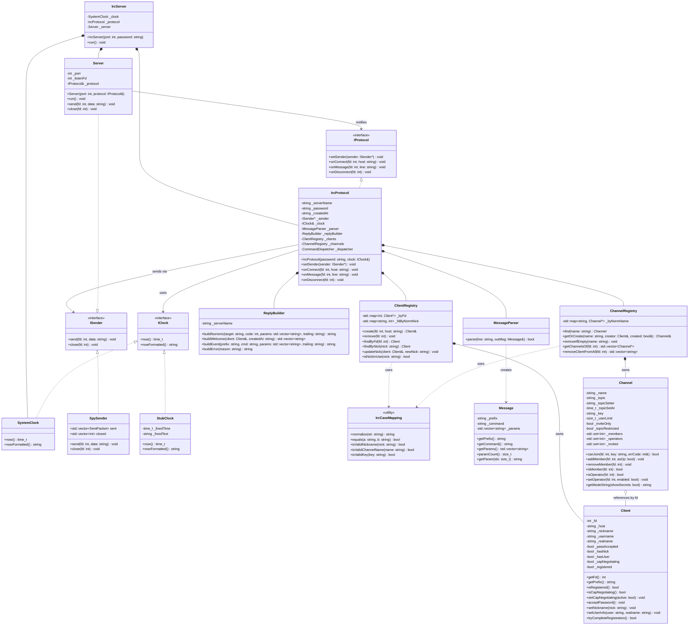
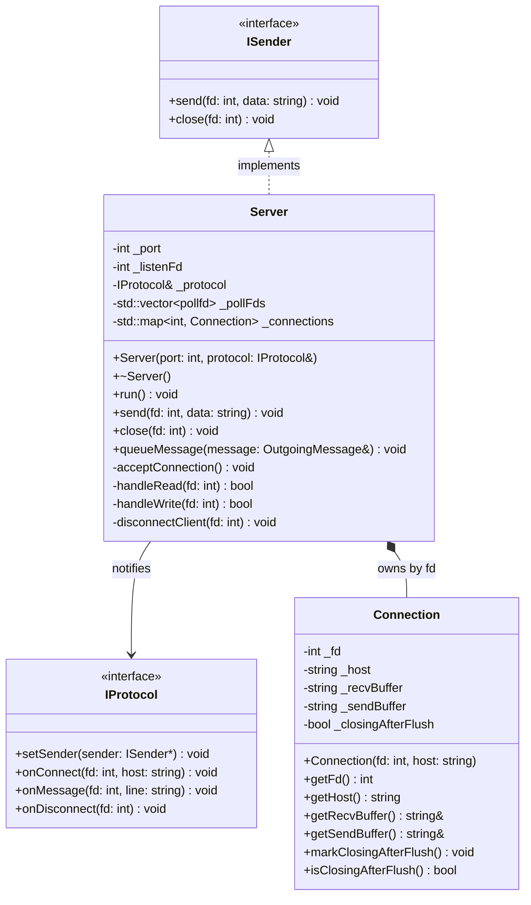
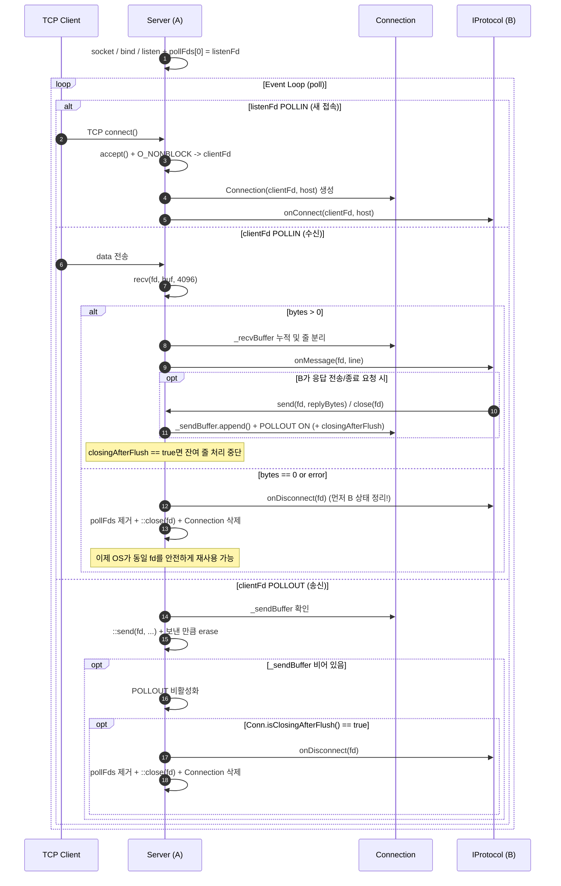
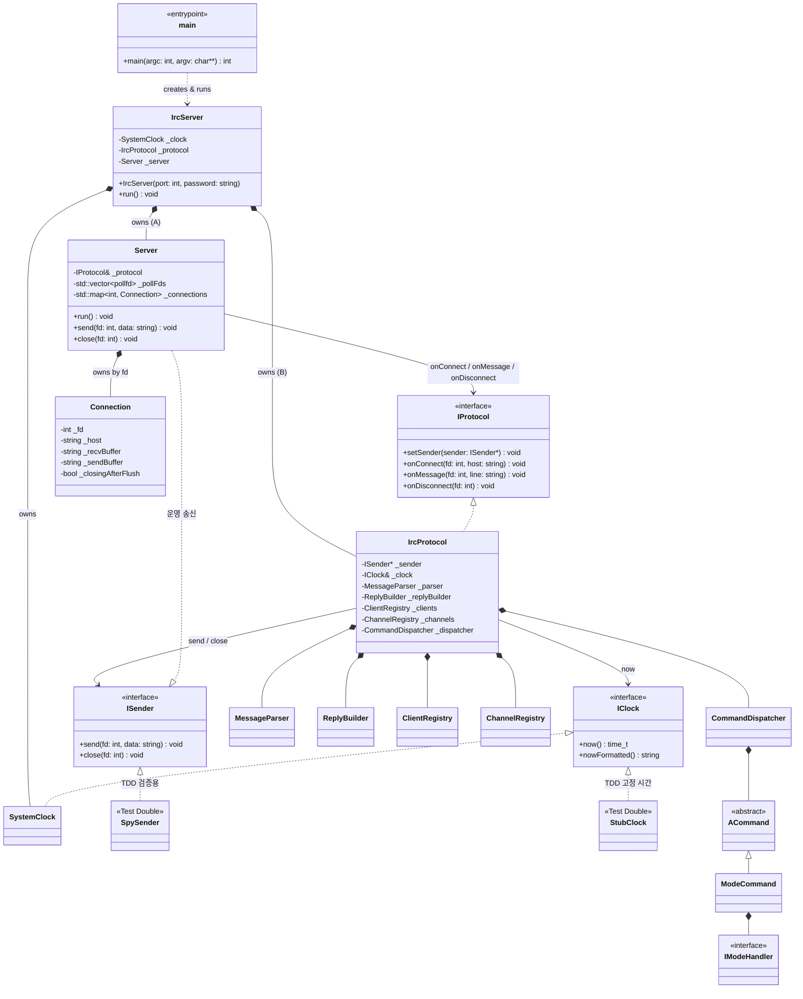
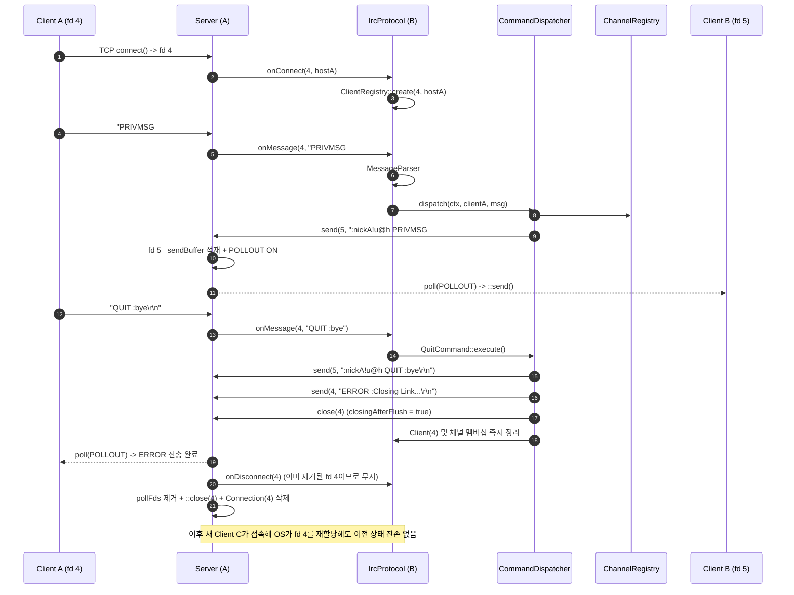

# ft_irc 3일 스프린트 & 최종 설계서 (IrcServer · Server · IrcProtocol)

> **결정 사항 (Confluence 팀 합의 + TDD 격리 반영)**:
> - `IrcServer`는 `SystemClock` + `IrcProtocol`(B) + `Server`(A)를 합성(Composition)한다.
> - `I` (`ISender`, `IClock`, `IProtocol`, `IModeHandler`)는 순수 인터페이스, `A` (`ACommand`)는 기본 구현을 가진 추상 클래스다.
> - OS 소켓 호출(`::send`, `::close`, `poll`)과 `std::time()`은 `ISender`/`IClock` 뒤로 격리해 B파트는 CppUTest에서 100% 독립 TDD로 개발한다.
> - **연결 식별자(`int fd` 공통 사용 & OS `fd` 재사용 수용)**: Confluence 설계서 및 기존 A파트 구현(`std::map<int, Connection>`, `IncomingMessage`/`OutgoingMessage`)에 맞춰 별도 `ConnectionId` 발급 없이 **`int fd`를 공통 식별자**로 사용한다.
> - **프레이밍(`\r\n` 분리) 위치 결정 유보**: B파트는 완성된 한 줄을 받는 `onMessage(int fd, const std::string& line)`을 중심 진입점으로 두고, 통합 단계(S3-1)에서 A파트 프레이밍을 유지할지 B 앞단에 `StreamFramer`를 둘지 최종 결정한다.
> - `NumericCode`는 `enum` 상수로 두고 `ReplyBuilder`에서 3자리 문자열로 변환한다.

> **목표**: **B파트(`IrcProtocol` & Command)를 CppUTest TDD로 완성**하고, **A파트(`Server`)와 통합 및 Reference Client 검증**까지 완료한다.

> **핵심 설계 원칙**
> - **최상위 합성 구조 (`IrcServer`)**: `IrcServer`가 `SystemClock`, `IrcProtocol`(B), `Server`(A)를 상속 없이 멤버로 합성(Composition)하여 조립한다.
> - **OS / 하드웨어 격리 (*TDD for Embedded C*)**: B파트 전체에서 `<sys/socket.h>`, `<poll.h>`, `<unistd.h>`, `<fcntl.h>` 및 `std::time()` 직접 호출을 금지한다. 식별자는 `int fd`를 쓰되 실제 OS 호출을 `ISender`와 `IClock` 뒤에 격리하여 CppUTest에서 가짜 정수(`fd = 4, 5` 등)만으로 100% 독립 실행한다.
> - **`I` (순수 인터페이스)**: 멤버 변수 0개, 순수 가상 함수(`= 0`) + 가상 소멸자만 보유 → `ISender`, `IClock`, `IProtocol`, `IModeHandler`
> - **`A` (추상 클래스)**: 공통 기본 동작 + 순수 가상 함수 보유 → `ACommand`

---

## 설계 결정 기록 (Confluence 대조 및 핵심 확인 사항)

### 1. 왜 별도 `ConnectionId` 대신 `int fd` 재사용 구조를 채택했는가?
- **Confluence 팀 합의 및 기존 A파트 구현 존중**: A파트(`IRC-31`, `IRC-33`, `IRC-34`)가 이미 `std::map<int, Connection>`, `IncomingMessage { int fd; std::string line; }`, `OutgoingMessage { int fd; std::string data; }`로 완성되어 있다. 별도 `_nextId++` 및 `_fdToId` 매핑을 추가하는 것은 단일 스레드 `poll()` 서버에서 과설계이며 A/B 경계 변경 부담을 키운다.
- **OS `fd` 재사용 안전성 조건 (단일 스레드 `poll()` 기준)**:
  1. **Disconnect 순서 보장**: A가 연결 종료를 감지하면 **반드시 `close(fd)` 이전에** B의 `onDisconnect(fd)`를 동기 호출한다. B가 해당 `fd`의 `Client`·`Channel` 멤버십을 즉시 정리한 뒤 A가 `_pollFds` 제거 → `::close(fd)` → `_connections.erase(fd)`를 수행하므로, OS가 다음 `accept()`에서 같은 `fd`를 재할당해도 이전 사용자 상태와 섞이지 않는다.
  2. **Flush-then-Close (`QUIT` 등) 및 UAF 방지**: B가 `ERROR` 전송 후 `ISender::close(fd)`를 호출할 때, A는 `Server::handleRead()` 도중 `_connections.erase(fd)`를 즉시 수행하지 않고 `Connection::_closingAfterFlush = true`로 표시한다.
     - `handleRead()`는 `_closingAfterFlush`가 켜지면 잔여 버퍼 줄 처리를 즉시 중단한다(댕글링 참조 `recvBuffer` 및 `QUIT` 이후 명령 실행 방지).
     - 실제 `::close(fd)`는 `handleWrite()`에서 `_sendBuffer`가 모두 비워진 뒤 수행되며, 그 사이 OS는 해당 `fd`를 재사용할 수 없다.
     - B도 `QUIT` 처리 시 `Client`를 즉시 정리하고, `onMessage`/`onDisconnect` 진입 시 `findByFd(fd) == NULL`이면 무시하여 중복 전파나 잔여 줄 실행을 이중 방어한다.
- **TDD 격리는 그대로 유지됨**: *TDD for Embedded C*의 격리 본질은 식별자 타입(`int` vs `unsigned long`)이 아니라 **OS 시스템 콜을 `ISender`/`IClock` 인터페이스 뒤로 숨기는 것**이다. `ISender::send(int fd, ...)` / `close(int fd)`를 써도 B파트는 OS 헤더 의존성 0개로 테스트 가능하다.

### 2. 프레이밍(`StreamFramer`)을 통합 단계(S3-1)에서 결정해도 되는가?
- **결론: 가능하다 (나중에 넣거나 빼도 기존 B파트 코드 수정 비용이 거의 0이다).**
- **이유**: `MessageParser`, `Client`, `ClientRegistry`, `ReplyBuilder`, `Channel`, `ChannelRegistry`, `CommandDispatcher`, 모든 `ACommand`·`IModeHandler`는 **이미 `\r\n`이 제거된 완성된 한 줄(`const std::string& line`)** 만 입력으로 받으며 `StreamFramer`에 전혀 의존하지 않는다.
- **유연한 진입점 설계**:
  - B파트(`IrcProtocol`)의 핵심 진입점을 `onMessage(int fd, const std::string& line)`으로 구현한다.
  - **통합 시 선택 A (Confluence 합의대로 A 프레이밍 유지)**: A의 `Server::handleRead()`가 추출한 `line`을 `_protocol.onMessage(fd, line)`으로 그대로 전달한다. (필요 시 A의 `handleRead()`에 `nc` 호환 `\n`, NUL 바이트 체크만 합의 후 보완)
  - **통합 시 선택 B (프로토콜 계층 원칙대로 B에 `StreamFramer` 추가)**: `IrcProtocol` 앞단에 `StreamFramer`와 `onReceive(int fd, const std::string& rawBytes)` 어댑터 1개만 추가해, 분리된 각 줄을 기존 `onMessage(fd, line)`으로 넘긴다. 기존 B파트 파서·도메인·명령 코드는 수정할 필요가 없으며, A의 `handleRead()`만 raw bytes 전달로 단순화하면 된다.

### 3. 적용된 디자인 패턴 및 템플릿 사용 방침

#### 적용된 디자인 패턴
| 패턴 | 적용 위치 | 적용 이유 및 효과 |
| :--- | :--- | :--- |
| **Composition / Facade** (합성 · 퍼사드) | `IrcServer`, `IrcProtocol` | `IrcServer`가 `SystemClock`·`IrcProtocol`·`Server`를 합성해 `run()`만 노출하고, `IrcProtocol`이 6개 내부 서브시스템을 감싸 `IProtocol` 진입점만 외부에 노출한다. |
| **Dependency Injection / Inversion** (의존성 주입 · 역전) | `ISender`, `IClock`, `IProtocol` | A/B 양쪽이 구체 클래스가 아닌 순수 인터페이스에만 의존한다. 운영 시 `Server`/`SystemClock`, 테스트 시 **Test Double (`SpySender`, `StubClock`)** 을 주입해 OS/시간과 100% 격리한다. |
| **Command** (커맨드) | `CommandDispatcher`, `ACommand`, 명령 16종 | IRC 명령을 객체로 캡슐화해 명령 문자열로 런타임 디스패치한다. 새 명령 추가 시 기존 분기문을 건드리지 않는다(OCP). |
| **Template Method (경량 훅)** | `CommandDispatcher::dispatch` + `ACommand` | 공통 실행 골격(등록 여부 `451` → 최소 인자 `461` → `execute()`)은 디스패처에 고정하고, 하위 명령은 `requiresRegistration()`·`minParams()`·`execute()` 훅만 오버라이드한다. |
| **Strategy** (전략) | `ModeCommand` + `IModeHandler` 5종 (`+i/+t/+k/+o/+l`) | 채널 모드 플래그별 파라미터 요구 여부(`needsParam`)와 적용 로직(`apply`)을 전략 객체로 분리해 거대 `switch`/`if-else`를 제거한다. |
| **Repository / Registry** (저장소) | `ClientRegistry`, `ChannelRegistry` | 도메인 객체(`Client`, `Channel`)의 소유권·생명주기와 다중 인덱스 조회(`fd` + 정규화 닉네임 $O(\log N)$, 빈 채널 자동 정리)를 캡슐화한다. |
| **Builder** (빌더 / 포매터) | `ReplyBuilder` | RFC 2812 응답/에러/Welcome(`001~004`)/이벤트 브로드캐스트 문자열 조립 규칙을 한 곳에 집중시킨다. |
| **State Machine (경량)** | `Client` 등록 상태 전이 | `_passAccepted`, `_hasNick`, `_hasUser`, `_capNegotiating`, `_registered` 조합을 `tryCompleteRegistration()`으로 일관되게 전이한다. |

#### C++ 템플릿 사용 방침
- **STL 컨테이너 템플릿만 적극 사용**: `std::vector`, `std::map`, `std::set`, `std::pair` 등 C++98 표준 컨테이너를 사용한다.
- **핵심 아키텍처에 커스텀 템플릿 클래스는 사용하지 않음**: 명령(`std::map<std::string, ACommand*>`)과 모드(`std::map<char, IModeHandler*>`)는 런타임 입력 문자열/문자에 따라 서로 다른 타입을 한 컨테이너에서 동적으로 호출해야 하므로, 컴파일 타임 템플릿보다 **가상 함수 기반 런타임 다형성**이 적합하다.
- **선택적 소규모 함수 템플릿(필요 시)**: C++98에는 `std::to_string`이 없으므로 숫자(`int`, `std::size_t`, `std::time_t`)를 문자열로 변환하는 `template <typename T> std::string toString(const T& value)` (`std::ostringstream` 래퍼)나 `std::map<K, V*>` 소멸자 정리 헬퍼 정도만 중복 제거용으로 고려할 수 있다.

---

## Part 1. 3일 스프린트 계획

### 운영 원칙 (Human-led + AI 페어 프로그래밍)
1. **사람이 주도하는 부분**: 티켓 분할, Test List·RFC 명세 확정, 직접 TDD 연습(Red → Green → Refactor), 경계 설계 리뷰, Git 커밋/PR/머지, 최종 통합 테스트
2. **AI의 역할**: TDD 코칭·설계 검증·리뷰 지원 (명시적 요청 시 티켓 단위 구현/테스트 작성)
3. **1 티켓 = 1 브랜치 = CppUTest 통과 후 Squash Merge** (WIP 동시 진행 금지: 한 번에 1티켓씩 완주)
4. **파일 구성 실용화**: 논리적 클래스 분리(SOLID)는 유지하되 일정에 맞춰 물리 파일 과다 분리를 피한다 (예: `ModeHandlers.hpp/.cpp`에 5개 모드 핸들러 함께 배치, 연관 소규모 명령 묶음 허용).

---

### Day 1: 기반 계층 · 파싱 · 인증 및 연결 생명주기
> **마일스톤**: B파트 단독 테스트에서 `접속 → PASS → NICK → USER → 001~004 Welcome → PING/PONG → QUIT` 흐름 통과

- [ ] **S1-1. 추상 경계 & 유틸 (`ISender`, `IProtocol`, `IClock`, `IrcCaseMapping`)**
  - `int fd` 기반 `ISender`, `IProtocol`, `IClock` 순수 인터페이스 확정 (`Types.hpp` 별도 ID 타입 없음)
  - RFC 2812 §2.2 대소문자 정규화(`{}|` ↔ `[]\`, `^` ↔ `~`) 및 RFC 2812 §2.3.1 닉네임(1~9자)/채널명(`#`/`&`, 2~50자)/키(1~23자) 유효성 검증 TDD
  - Test Double: `SpySender`, `StubClock` 구축
- [ ] **S1-2. 메시지 파싱 (`Message`, `MessageParser`)**
  - `MessageParser`: 완성된 한 줄(`line`)을 `[:prefix] COMMAND [params...]` 구조로 파싱 (최대 15개 파라미터, `:trailing`, 대소문자 정규화, 빈 줄 및 NUL(`0x00`) 방어)
  - *(프레이밍 `StreamFramer`는 통합 단계 S3-1에서 A 프레이밍 유지 vs B 이전 여부 최종 결정 시 필요하면 추가)*
- [ ] **S1-3. 사용자 모델 & 응답 포매터 (`Client`, `ClientRegistry`, `ReplyBuilder`)**
  - `Client`: `int _fd`, `PASS`/`NICK`/`USER`/`_capNegotiating` 등록 상태 머신, `nick!user@host` prefix 생성
  - `ClientRegistry`: `int fd` 조회 및 정규화 닉네임 중복 인덱스($O(\log N)$)
  - `ReplyBuilder`: RFC 2812 §2.4 `:serverName XXX target ... :trailing\r\n`, `001~004` Welcome (`NumericCode` enum 활용)
- [ ] **S1-4. 디스패처 & 등록/연결 명령 (`ACommand`, `CommandDispatcher`, 인증/연결 명령 7종)**
  - `CommandDispatcher`: `requiresRegistration()`(`451`), `minParams()`(`461`), 미지 명령(`421`) 공통 검사
  - 구현 명령: `PASS`, `NICK` (중복 `433`·형식 `432`·변경 브로드캐스트), `USER`, `CAP` (`LS` 시 등록 보류 → `END` 시 완료), `PING`, `PONG`, `QUIT` (`ERROR` + `close(fd)` + `Client` 즉시 정리로 중복 브로드캐스트 방지)

---

### Day 2: 채널 · 메시징 · Operator 명령 & B파트 완성
> **마일스톤**: 모든 Mandatory IRC 명령이 `SpySender` 기반 다중 클라이언트 CppUTest 시나리오를 통과

- [ ] **S2-1. 채널 도메인 & 저장소 (`Channel`, `ChannelRegistry`)**
  - 멤버/Op/초대 목록 (`std::set<int>` — `fd` 기준), `canJoin()` (`+i`, `+k`, `+l` 검증 및 에러 코드 반환)
  - `ChannelRegistry`: 정규화 채널명 조회/생성, 연결 종료 시 전체 채널 일괄 정리 및 빈 채널 삭제
- [ ] **S2-2. 채널 입장·퇴장 명령 (`JOIN`, `PART`, `NAMES`)**
  - `JOIN`: 다중 채널/키(`,`), `JOIN 0` 전체 탈퇴, 첫 생성자 `+o`, `JOIN` 에코 + `332`/`353`/`366` 응답
  - `PART`: 채널 탈퇴 브로드캐스트 및 빈 채널 정리
  - `NAMES`: 채널 멤버 목록(`353`/`366`) 조회
- [ ] **S2-3. 메시징 명령 (`PRIVMSG`, `NOTICE`)**
  - `PRIVMSG`: 개인(닉네임) 및 채널 브로드캐스트(발신자 제외), 다중 타깃(`,`), `401`/`404` 에러
  - `NOTICE`: `PRIVMSG`와 동일 라우팅이되 RFC 2812 §3.3.2에 따라 **어떠한 오류 응답도 생성 금지**
- [ ] **S2-4. 관리자 명령 (`TOPIC`, `INVITE`, `KICK`, `MODE` + `IModeHandler` 5종)**
  - `TOPIC`: 조회(`331`/`332`), 변경(`+t` 설정 시 Op 권한 `482` 검사)
  - `INVITE`: 초대 권한 검사, `341 RPL_INVITING`, 대상 알림
  - `KICK`: Op 권한·대상 멤버 확인, 퇴출 브로드캐스트
  - `MODE`:
    - 채널 대상(`#`/`&`): 모드 조회(`324`), 밴 목록 조회 `MODE #chan b` (`368 RPL_ENDOFBANLIST` 예외 호환), 복합 플래그(`+itk-ol`) 순차 파싱 및 `Invite`/`Topic`/`Key`/`Operator`/`Limit` 핸들러 적용
    - 유저 대상(닉네임): `221 RPL_UMODEIS` 등 Irssi 자동 유저 모드 명령 호환 처리 (`403` 방지)
- [ ] **S2-5. `IrcProtocol` 최종 조립 & E2E 도메인 테스트**
  - `onConnect(fd, host)` / `onMessage(fd, line)` / `onDisconnect(fd)` 연결
  - `QUIT` 이후 같은 `fd`로 들어오는 잔여 줄을 `findByFd(fd) != NULL` 재확인으로 차단 검증
  - 비정상 단절(`onDisconnect(fd)`) 시 공유 채널 피어에게 `QUIT :Connection closed` 전파 및 닉네임/채널 정리 검증
  - **동일 `fd` 번호 재사용 시나리오 검증**: `fd 4` 종료(`QUIT` 또는 `onDisconnect`) 직후 새 클라이언트가 `onConnect(4, ...)`로 재접속했을 때 이전 닉네임·인증·채널 상태가 전혀 남지 않음 확인

---

### Day 3: A(`Server`) / B(`IrcProtocol`) 통합 · 검증 · 마무리
> **마일스톤**: `./ircserv <port> <password>` 실행 상태에서 다중 클라이언트 및 Reference Client(Irssi 등) 통과

- [ ] **S3-1. `IrcServer` 합성 조립 & `Server` 경계 연동 (`make re`)**
  - `Server`가 `ISender`(`send(fd, data)` → 기존 `queueMessage` 위임, `close(fd)` → `_closingAfterFlush` Flush-then-Close)를 구현하고 `IProtocol&`(`onConnect`, `onMessage`, `onDisconnect`)과 연결
  - `Server::disconnectClient(fd)`에서 **`_protocol.onDisconnect(fd)`를 `close(fd)`보다 먼저 호출**하도록 순서 보장
  - `Server::handleRead(fd)`에서 `_closingAfterFlush` 설정 시 잔여 버퍼 줄 실행 즉시 중단 확인
  - `IrcServer`에서 `SystemClock` + `IrcProtocol` + `Server` 합성 조립 (`_protocol.setSender(&_server)`)
  - **프레이밍 최종 결정 및 적용**:
    - Option A(A 프레이밍 유지): `Server::handleRead`에 `nc` 개행(`\n`)·NUL 바이트 처리 보완 후 `onMessage(fd, line)` 연결
    - Option B(B 프레이밍 이전): `IrcProtocol` 앞단에 `StreamFramer` + `onReceive(fd, rawBytes)` 어댑터 추가하고 `Server::handleRead`는 raw bytes 전달로 단순화
- [ ] **S3-2. 네트워크 예외 & 부하 테스트 (`nc` / Python 스크립트)**
  - Partial recv (명령 1개를 여러 패킷으로 분할 전송) 및 한 번에 여러 명령 전송
  - `nc` 개행(`\n`) 및 RFC 개행(`\r\n`) 호환 확인
  - Partial send / 느린 클라이언트(`POLLOUT`) 및 512바이트 초과·NUL 바이트 처리
  - 강제 종료(`SIGPIPE` 무시, `Ctrl+C` / `RST`) 후 재접속 및 **동일 `fd`·닉네임·채널 재사용** 검증
- [ ] **S3-3. Reference Client 검증 & 제출 체크리스트 마무리**
  - Irssi(또는 HexChat/WeeChat)로 접속, 채널 대화, KICK/INVITE/TOPIC/MODE `i/t/k/o/l` 실전 점검
  - 메모리 누수 점검(Valgrind 등), `-Wall -Wextra -Werror -std=c++98` 확인
  - `README.md` 필수 양식 확인 및 팀 레포(`upstream`) 최종 PR 생성

---

## Part 2. 전체 및 B파트 UML 설계서

### 1. 테스트 격리를 위한 외부 경계

| 순수 인터페이스 (`I`) | 운영 구현체 (`IrcServer` 조립 시) | 테스트용 Test Double (TDD 시) | 역할 |
| :--- | :--- | :--- | :--- |
| **`IProtocol`** | `IrcProtocol` | *(테스트 대상)* | 연결/메시지 이벤트 수신 (`onConnect(fd, host)`, `onMessage(fd, line)`, `onDisconnect(fd)`) |
| **`ISender`** | `Server` (A파트) | **`SpySender`** | 송신 문자열 적재 및 종료 예약 (`send(fd, data)`, `close(fd)`) |
| **`IClock`** | `SystemClock` | **`StubClock`** | `003 RPL_CREATED`, `TOPIC` 설정 시각 등을 고정값으로 반환해 결정적 테스트 보장 |

---

### 2. 데이터 처리 파이프라인

```plaintext
Server (A파트, std::map<int, Connection>, OS fd 재사용)
  ├── onConnect(fd, host)  ──▶ IrcProtocol ──▶ ClientRegistry::create(fd, host)
  ├── onMessage(fd, line)  ──▶ [※ 통합 시 B 프레이밍 선택 시 앞단에 StreamFramer(onReceive) 어댑터 추가]
  │                                │
  │                           findByFd(fd) != NULL 확인
  │                                │
  │                                ▼
  │                           MessageParser (prefix, 대소문자 정규화 command, 최대 15 params)
  │                                │
  │                                ▼
  │                         CommandDispatcher (등록 여부 451 / 최소 인자 461 / 미지 명령 421)
  │                                │
  │                                ▼
  │                        ACommand::execute(ctx, client, msg)
  │                          ├── ClientRegistry / ChannelRegistry 상태 변경
  │                          └── ReplyBuilder 포맷 생성 ──▶ ISender::send(fd, ...) / close(fd) ──▶ Server
  └── onDisconnect(fd)     ──▶ IrcProtocol (살아있는 Client면 피어에 QUIT 전파 후 즉시 정리)
                                   │ (동기 완료 후)
                                   ▼
                               Server: pollFds 제거 + ::close(fd) + Connection 삭제 (fd 안전 재사용)
```

---

### 3. UML 클래스 다이어그램

#### 3-1. 최상위 조립(`IrcServer`) · A/B 경계 · B파트 코어/도메인



#### 3-2. Command 실행 계층(`ACommand`) & MODE 전략 패턴(`IModeHandler`)

```mermaid
classDiagram
    direction TB

    class CommandContext {
        +ClientRegistry& clients
        +ChannelRegistry& channels
        +ReplyBuilder& replies
        +ISender& sender
        +IClock& clock
        +string serverName
        +string password
        +string createdAt
        +sendNumeric(client: Client&, code: int, params: std::vector~string~, trailing: string) void
        +broadcastChannel(chan: Channel&, raw: string, excludeFd: int) void
        +broadcastPeers(client: Client&, raw: string, includeSelf: bool) void
    }

    class CommandDispatcher {
        -std::map~string, ACommand*~ _commands
        +registerCommand(name: string, cmd: ACommand*) void
        +dispatch(ctx: CommandContext&, client: Client&, msg: Message) void
    }

    class ACommand {
        <<abstract>>
        +requiresRegistration() bool
        +minParams() size_t
        +execute(ctx: CommandContext&, client: Client&, msg: Message)*
    }

    class PassCommand
    class NickCommand
    class UserCommand
    class CapCommand
    class QuitCommand
    class PingCommand
    class PongCommand
    class JoinCommand
    class PartCommand
    class PrivmsgCommand
    class NoticeCommand
    class NamesCommand
    class KickCommand
    class InviteCommand
    class TopicCommand

    class ModeCommand {
        -std::map~char, IModeHandler*~ _handlers
        +execute(ctx: CommandContext&, client: Client&, msg: Message) void
    }

    class IModeHandler {
        <<interface>>
        +needsParam(adding: bool) bool
        +apply(ctx: CommandContext&, chan: Channel&, actor: Client&, adding: bool, param: string, outApplied: string&) bool
    }

    class InviteModeHandler
    class TopicModeHandler
    class KeyModeHandler
    class OperatorModeHandler
    class LimitModeHandler

    CommandDispatcher *-- ACommand : owns
    CommandDispatcher ..> CommandContext : passes

    ACommand <|-- PassCommand
    ACommand <|-- NickCommand
    ACommand <|-- UserCommand
    ACommand <|-- CapCommand
    ACommand <|-- QuitCommand
    ACommand <|-- PingCommand
    ACommand <|-- PongCommand
    ACommand <|-- JoinCommand
    ACommand <|-- PartCommand
    ACommand <|-- PrivmsgCommand
    ACommand <|-- NoticeCommand
    ACommand <|-- NamesCommand
    ACommand <|-- KickCommand
    ACommand <|-- InviteCommand
    ACommand <|-- TopicCommand
    ACommand <|-- ModeCommand

    ModeCommand *-- IModeHandler : owns by flag
    IModeHandler <|.. InviteModeHandler
    IModeHandler <|.. TopicModeHandler
    IModeHandler <|.. KeyModeHandler
    IModeHandler <|.. OperatorModeHandler
    IModeHandler <|.. LimitModeHandler
```



---

### 4. 각 티켓의 TDD 실행 체크리스트 (*TDD for Embedded C* 스타일)

1. **브랜치 생성**: `git switch main && git pull origin main && git switch -c feature/IRC-XX-...`
2. **Test List 작성**: 해당 티켓의 입력·기대 동작(RFC 코드/경계값)을 ZOMBIES 순서로 정리
3. **Red**: 목록에서 가장 작은 테스트 1개 작성 → `make -C test run` 실패 확인
4. **Green**: 그 테스트를 통과하는 최소한의 C++98 구현 작성 → `make -C test run` 통과
5. **Refactor & Review**: 중복 제거, 메모리 누수·포인터 소유권·`-Wall -Wextra -Werror` 확인 후 테스트 재실행
6. **Commit / PR / Merge**:
   - `git commit -m "feat(scope): ... [IRC-XX]"`
   - Push → Squash & Merge → 로컬 브랜치 정리 → Jira `Done`

---

## Part 3. A파트 설계 및 UML (`Server` · `Connection`)

> **A파트 역할**: TCP 소켓 수명(`socket`, `bind`, `listen`, `accept`), 단일 `poll()` 이벤트 루프, 논블로킹 `recv`/`send`, `fd` 기반 `Connection` 관리(OS `fd` 재사용 수용), `POLLOUT` 및 `close()`(Flush-then-Close)를 담당한다. IRC 문법이나 사용자/채널 상태는 전혀 알지 못한다.

### 1. A파트 UML 클래스 다이어그램



> **참고 (프레이밍 결정 유보)**: 현재 A파트(`src/Server.cpp`)는 `Connection::_recvBuffer`에서 `\r\n` 단위로 한 줄을 잘라 `onMessage(fd, line)`으로 전달하는 구조다. 통합 단계(S3-1)에서 프로토콜 프레이밍을 B로 옮기기로 결정하면 `IrcProtocol` 앞단에 `StreamFramer` + `onReceive(fd, rawBytes)` 어댑터를 붙이고 A의 `handleRead`에서 `recv` 바이트를 그대로 전달하도록 전환할 수 있다.

---

### 2. A파트 동작 시퀀스 (`poll` 루프 · 송신 · Flush 후 종료 · `fd` 재사용)



---

## Part 4. 전체 통합 UML (`IrcServer` · A파트 · B파트 · Test Doubles)

### 1. 전체 시스템 통합 클래스 다이어그램



---

### 2. 전체 통합 시퀀스 다이어그램 (접속 → `PRIVMSG` → `QUIT` → 동일 `fd` 재접속)


