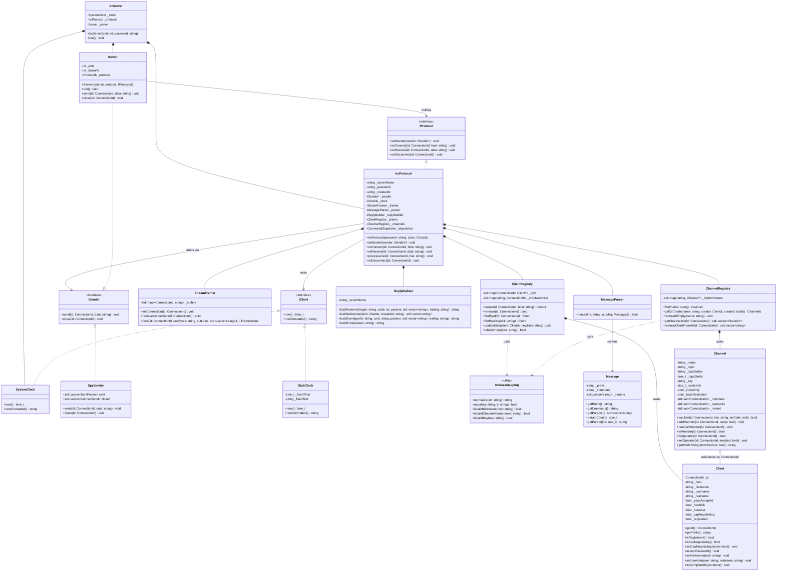
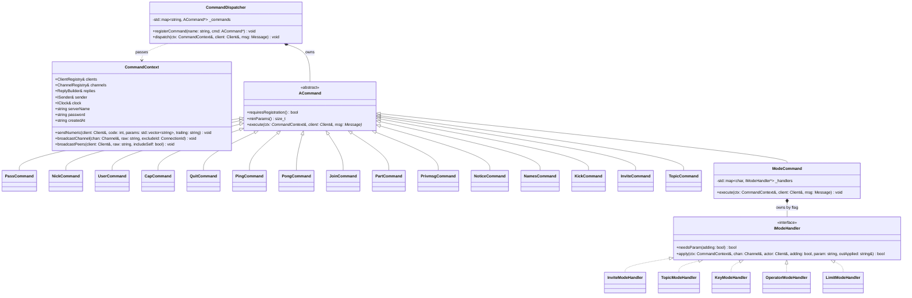
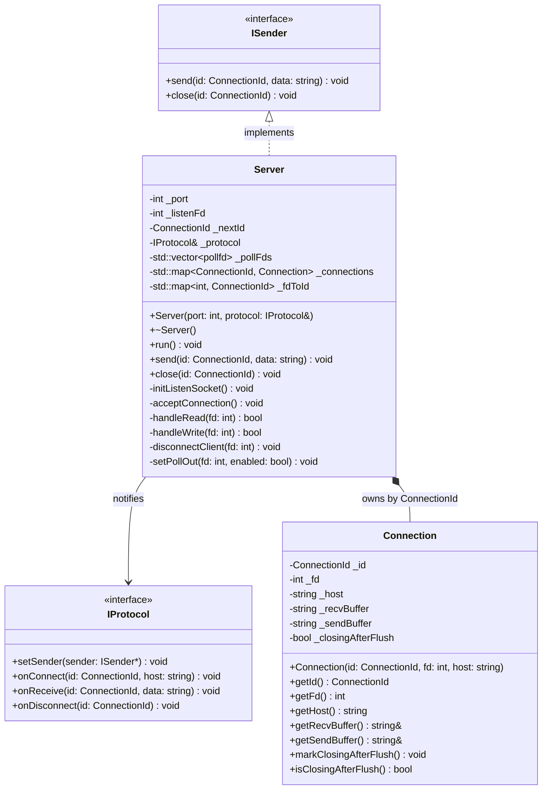
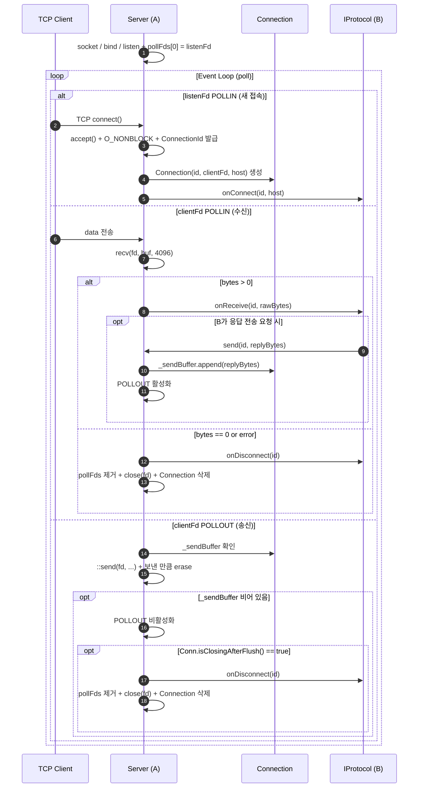
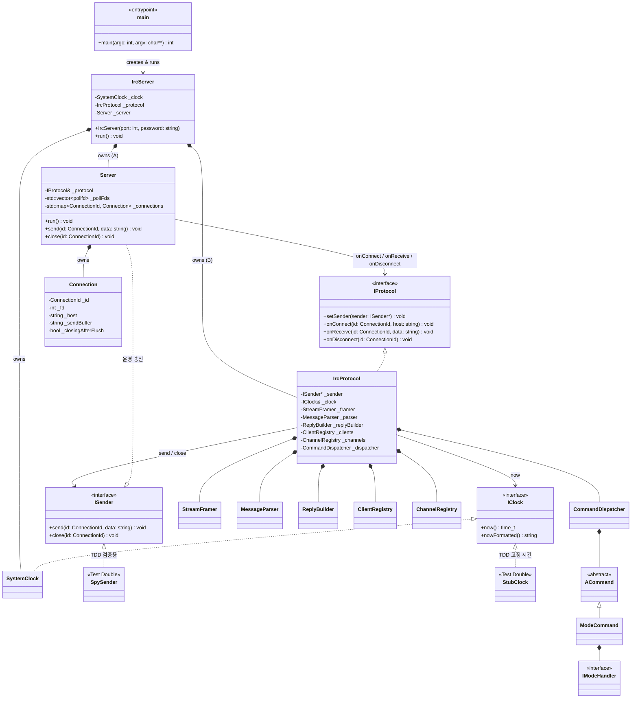
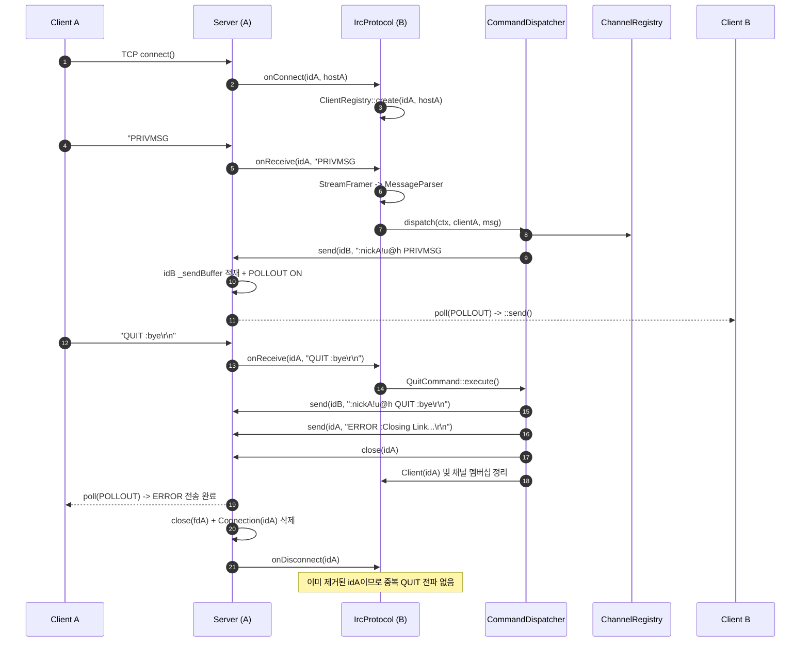

# ft_irc 3일 스프린트 & 최종 설계서 (IrcServer · Server · IrcProtocol)

> **결정 사항**:
- IrcServer는 SystemClock + IrcProtocol + Server를 합성(Composition)한다.
- I (ISender, IClock, IProtocol, IModeHandler)는 순수 인터페이스, A (ACommand)는 기본 구현을 가진 추상 클래스다.
- OS 소켓/time()은 ISender/IClock 뒤로 격리해 B파트는 CppUTest에서 100% 독립 TDD로 개발한다.
- 연결 식별자는 fd 대신 ConnectionId(onConnect, onReceive, onDisconnect)를 사용한다.
- NumericCode는 enum 상수로 두고 ReplyBuilder에서 3자리 문자열로 변환한다.


> **목표**: 2026-11-25(수) ~ 11-27(금)까지 **B파트(`IrcProtocol` & Command)를 CppUTest TDD로 완성**하고, **A파트(`Server`)와 통합 및 Reference Client 검증**까지 완료한다.

> **핵심 설계 원칙**
> - **최상위 합성 구조 (`IrcServer`)**: `IrcServer`가 `SystemClock`, `IrcProtocol`(B), `Server`(A)를 상속 없이 멤버로 합성(Composition)하여 조립한다.
> - **OS / 하드웨어 격리 (*TDD for Embedded C*)**: B파트 전체에서 `<sys/socket.h>`, `<poll.h>`, `<unistd.h>`, `<fcntl.h>` 및 `std::time()` 직접 호출을 금지한다. 외부 경계는 `ISender`와 `IClock` 뒤에 격리하여 CppUTest에서 100% 독립 실행한다.
> - **식별자 추상화 (`ConnectionId`)**: OS 소켓 번호(`int fd`) 대신 연결 식별자(`typedef unsigned long ConnectionId;`)를 사용한다.
> - **`I` (순수 인터페이스)**: 멤버 변수 0개, 순수 가상 함수(`= 0`) + 가상 소멸자만 보유 → `ISender`, `IClock`, `IProtocol`, `IModeHandler`
> - **`A` (추상 클래스)**: 공통 기본 동작 + 순수 가상 함수 보유 → `ACommand`

---

## Part 1. 3일 스프린트 계획 (2026-11-25 ~ 11-27)

### 운영 원칙 (Human-led + AI 가속 사이클)
1. **사람이 주도하는 부분**: 티켓 분할, RFC/테스트 케이스 승인, 경계 설계 리뷰, Git 커밋/PR/머지, 최종 통합 테스트
2. **AI에 위임하는 부분 (티켓 단위)**: 승인된 테스트 명세 기반 CppUTest 작성(Red) → C++98 구현(Green) → 리팩터링(Refactor)
3. **1 티켓 = 1 브랜치 = CppUTest 통과 후 Squash Merge** (WIP 동시 진행 금지: 한 번에 1티켓씩 완주)
4. **파일 구성 실용화**: 논리적 클래스 분리(SOLID)는 유지하되 3일 일정에 맞춰 물리 파일 과다 분리를 피한다 (예: `ModeHandlers.hpp/.cpp`에 5개 모드 핸들러 함께 배치, 연관 소규모 명령 묶음 허용).

---

### Day 1 — 2026-11-25 (수): 기반 계층 · 파싱 · 인증 및 연결 생명주기
> **마일스톤**: B파트 단독 테스트에서 `접속 → PASS → NICK → USER → 001~004 Welcome → PING/PONG → QUIT` 흐름 통과

- [ ] **S1-1. 추상 경계 & 유틸 (`Types`, `ISender`, `IProtocol`, `IClock`, `IrcCaseMapping`)**
  - `ConnectionId`, `ISender`, `IProtocol`, `IClock` 순수 인터페이스 확정
  - RFC 2812 §2.2 대소문자 정규화(`{}|` ↔ `[]\`, `^` ↔ `~`) 및 닉네임/채널명/키 유효성 검증 TDD
  - Test Double: `SpySender`, `StubClock` 구축
- [ ] **S1-2. 프레이밍 & 메시지 파싱 (`StreamFramer`, `Message`, `MessageParser`)**
  - `StreamFramer`: 연결(`ConnectionId`)별 버퍼, `\r\n` 및 `nc` 호환 `\n` 기준 추출(`\r` 선택적 제거), 512바이트 제한, NUL(`0x00`) 거부, 빈 줄 무시
  - `MessageParser`: `[:prefix] COMMAND [params...]` (최대 15개, `:trailing`, 대소문자 정규화)
- [ ] **S1-3. 사용자 모델 & 응답 포매터 (`Client`, `ClientRegistry`, `ReplyBuilder`)**
  - `Client`: `PASS`/`NICK`/`USER`/`_capNegotiating` 등록 상태 머신, `nick!user@host` prefix 생성
  - `ClientRegistry`: `ConnectionId` 조회 및 정규화 닉네임 중복 인덱스($O(\log N)$)
  - `ReplyBuilder`: RFC 2812 §2.4 `:serverName XXX target ... :trailing\r\n`, `001~004` Welcome (`NumericCode` enum 활용)
- [ ] **S1-4. 디스패처 & 등록/연결 명령 (`ACommand`, `CommandDispatcher`, 인증/연결 명령 7종)**
  - `CommandDispatcher`: `requiresRegistration()`(`451`), `minParams()`(`461`), 미지 명령(`421`) 공통 검사
  - 구현 명령: `PASS`, `NICK` (중복 `433`·형식 `432`·변경 브로드캐스트), `USER`, `CAP` (`LS` 시 등록 보류 → `END` 시 완료), `PING`, `PONG`, `QUIT` (`ERROR` + `close` + `Client` 즉시 정리로 중복 브로드캐스트 방지)

---

### Day 2 — 2026-11-26 (목): 채널 · 메시징 · Operator 명령 & B파트 완성
> **마일스톤**: 모든 Mandatory IRC 명령이 `SpySender` 기반 다중 클라이언트 CppUTest 시나리오를 통과

- [ ] **S2-1. 채널 도메인 & 저장소 (`Channel`, `ChannelRegistry`)**
  - 멤버/Op/초대 목록, `canJoin()` (`+i`, `+k`, `+l` 검증 및 에러 코드 반환)
  - `ChannelRegistry`: 정규화 채널명 조회/생성, 연결 종료 시 전체 채널 일괄 정리 및 빈 채널 삭제
- [ ] **S2-2. 채널 입장·퇴장 명령 (`JOIN`, `PART`, `NAMES`)**
  - `JOIN`: 다중 채널/키(`,`), `JOIN 0` 전체 탈퇴, 첫 생성자 `+o`, `JOIN` 에코 + `332`/`353`/`366` 응답
  - `PART`: 채널 탈퇴 브로드캐스트 및 빈 채널 정리
  - `NAMES`: 채널 멤버 목록(`353`/`366`) 조회
- [ ] **S2-3. 메시징 명령 (`PRIVMSG`, `NOTICE`)**
  - `PRIVMSG`: 개인(닉네임) 및 채널 브로드캐스트(발신자 제외), 다중 타깃(`,`), `401`/`404` 에러
  - `NOTICE`: `PRIVMSG`와 동일 라우팅이되 RFC 2812 §3.3.2에 따라 **어떠한 오류 응답도 생성 금지**
- [ ] **S2-4. 관리자 명령 (`TOPIC`, `INVITE`, `KICK`, `MODE` + `IModeHandler` 5종)**
  - `TOPIC`: 조회(`331`/`332`), 변경(`+t` 설정 시 Op 권한 `482` 검사)
  - `INVITE`: 초대 권한 검사, `341 RPL_INVITING`, 대상 알림
  - `KICK`: Op 권한·대상 멤버 확인, 퇴출 브로드캐스트
  - `MODE`:
    - 채널 대상(`#`/`&`): 모드 조회(`324`), 밴 목록 조회 `MODE #chan b` (`368 RPL_ENDOFBANLIST` 예외 호환), 복합 플래그(`+itk-ol`) 순차 파싱 및 `Invite`/`Topic`/`Key`/`Operator`/`Limit` 핸들러 적용
    - 유저 대상(닉네임): `221 RPL_UMODEIS` 등 Irssi 자동 유저 모드 명령 호환 처리 (`403` 방지)
- [ ] **S2-5. `IrcProtocol` 최종 조립 & E2E 도메인 테스트**
  - `onConnect` / `onReceive` / `processLine` / `onDisconnect` 연결
  - 한 패킷에 `QUIT`과 후속 명령이 함께 올 때 `findById(id) != NULL` 재확인으로 잔여 줄 실행 차단 검증
  - 비정상 단절(`onDisconnect`) 시 공유 채널 피어에게 `QUIT :Connection closed` 전파 및 닉네임/채널 정리 검증

---

### Day 3 — 2026-11-27 (금): A(`Server`) / B(`IrcProtocol`) 통합 · 검증 · 마무리
> **마일스톤**: `./ircserv <port> <password>` 실행 상태에서 다중 클라이언트 및 Reference Client(Irssi 등) 통과

- [ ] **S3-1. `IrcServer` 합성 조립 & `Server` 경계 연동 (`make re`)**
  - `Server`가 `ISender`(`send`, `close`)를 구현하고 `IProtocol&`(`onConnect`, `onReceive`, `onDisconnect`)과 연결되도록 보완
  - `IrcServer`에서 `SystemClock` + `IrcProtocol` + `Server` 합성 조립 (`_protocol.setSender(&_server)`)
  - 개행(`\r\n` / `\n`) 및 프레이밍 경계(`StreamFramer` vs `processLine`) 일원화 확정
- [ ] **S3-2. 네트워크 예외 & 부하 테스트 (`nc` / Python 스크립트)**
  - Partial recv (명령 1개를 여러 패킷으로 분할 전송) 및 한 번에 여러 명령 전송
  - `nc` 개행(`\n`) 및 RFC 개행(`\r\n`) 호환 확인
  - Partial send / 느린 클라이언트(`POLLOUT`) 및 512바이트 초과·NUL 바이트 처리
  - 강제 종료(`SIGPIPE` 무시, `Ctrl+C` / `RST`) 후 재접속 및 닉네임·채널 재사용 검증
- [ ] **S3-3. Reference Client 검증 & 제출 체크리스트 마무리**
  - Irssi(또는 HexChat/WeeChat)로 접속, 채널 대화, KICK/INVITE/TOPIC/MODE `i/t/k/o/l` 실전 점검
  - 메모리 누수 점검(Valgrind 등), `-Wall -Wextra -Werror -std=c++98` 확인
  - `README.md` 필수 양식 확인 및 팀 레포(`upstream`) 최종 PR 생성

---

## Part 2. 전체 및 B파트 UML 설계서

### 1. 테스트 격리를 위한 외부 경계

| 순수 인터페이스 (`I`) | 운영 구현체 (`IrcServer` 조립 시) | 테스트용 Test Double (TDD 시) | 역할 |
| :--- | :--- | :--- | :--- |
| **`IProtocol`** | `IrcProtocol` | *(테스트 대상)* | 네트워크 이벤트 수신 (`onConnect`, `onReceive`, `onDisconnect`) |
| **`ISender`** | `Server` (A파트) | **`SpySender`** | 송신 문자열 적재 및 종료 예약 (`send(id, data)`, `close(id)`) |
| **`IClock`** | `SystemClock` | **`StubClock`** | `003 RPL_CREATED`, `TOPIC` 설정 시각 등을 고정값으로 반환해 결정적 테스트 보장 |

---

### 2. 데이터 처리 파이프라인

```plaintext
Server (A파트)
  ├── onConnect(id, host) ──▶ IrcProtocol ──▶ ClientRegistry::create()
  ├── onReceive(id, data) ──▶ StreamFramer (\r\n 및 \n 분리, 512B, NUL)
  │                                │
  │                           processLine(id, line) [매 줄 findById(id) != NULL 확인]
  │                                │
  │                                ▼
  │                           MessageParser (prefix, 대소문자 정규화 command, 최대 15 params)
  │                                │
  │                                ▼
  │                         CommandDispatcher (등록 여부 451 / 최소 인자 461 / 미지 명령 421)
  │                                │
  │                                ▼
  │                        ACommand::execute(ctx, client, msg)
  │                          ├── ClientRegistry / ChannelRegistry 상태 변경
  │                          └── ReplyBuilder 포맷 생성 ──▶ ISender::send() / close() ──▶ Server
  └── onDisconnect(id)    ──▶ IrcProtocol (살아있는 Client면 피어에 QUIT 전파 후 정리)
```

---

### 3. UML 클래스 다이어그램

#### 3-1. 최상위 조립(`IrcServer`) · A/B 경계 · B파트 코어/도메인



#### 3-2. Command 실행 계층(`ACommand`) & MODE 전략 패턴(`IModeHandler`)



---

### 4. 각 티켓의 빠른 TDD + AI 실행 체크리스트

1. **브랜치 생성**: `git switch main && git pull origin main && git switch -c feature/IRC-XX-...`
2. **명세 확정 (사람)**: 해당 티켓의 입력·기대 응답(RFC 코드) 목록 결정
3. **Red (AI)**: CppUTest 테스트 파일 작성 → `make -C test run` 실패 확인
4. **Green (AI)**: 최소한의 C++98 구현 작성 → `make -C test run` 통과
5. **Refactor & Review (사람 + AI)**: 중복 제거, 메모리 누수·포인터 소유권·`-Wall -Wextra -Werror` 확인
6. **Commit / PR / Merge**:
   - `git commit -m "feat(scope): ... [IRC-XX]"`
   - Push → Squash & Merge → 로컬 브랜치 정리 → Jira `Done`
## Part 3. A파트 설계 및 UML (`Server` · `Connection`)

> **A파트 역할**: TCP 소켓 수명(`socket`, `bind`, `listen`, `accept`), 단일 `poll()` 이벤트 루프, 논블로킹 `recv`/`send`, `ConnectionId` ↔ `fd` 매핑, `POLLOUT` 및 `close()`(Flush-then-Close)를 담당한다. IRC 문법이나 사용자/채널 상태는 전혀 알지 못한다.

### 1. A파트 UML 클래스 다이어그램



> **참고**: `Connection::_recvBuffer`는 A파트가 raw 바이트만 넘길 때는 사용하지 않고(`IrcProtocol::StreamFramer` 사용), 기존 팀원 코드처럼 A파트가 `\r\n`까지 잘라 줄 때는 유지합니다.

---

### 2. A파트 동작 시퀀스 (`poll` 루프 · 송신 · Flush 후 종료)



---

## Part 4. 전체 통합 UML (`IrcServer` · A파트 · B파트 · Test Doubles)

### 1. 전체 시스템 통합 클래스 다이어그램



---

### 2. 전체 통합 시퀀스 다이어그램 (접속 → `PRIVMSG` → `QUIT`)

